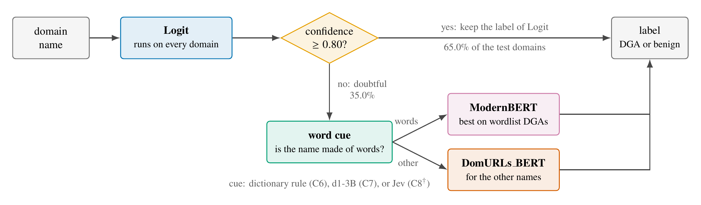
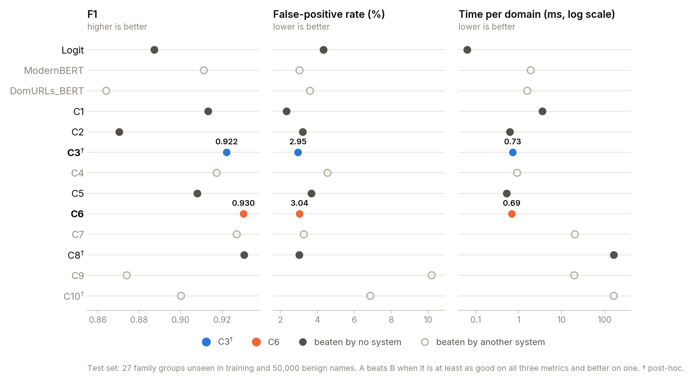
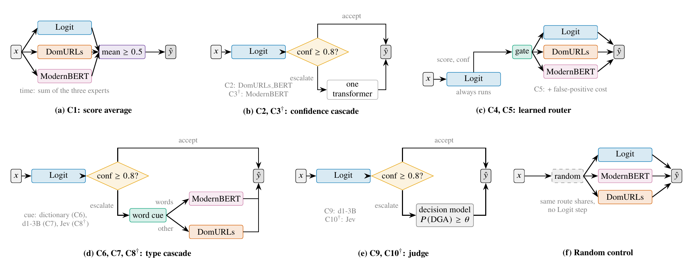
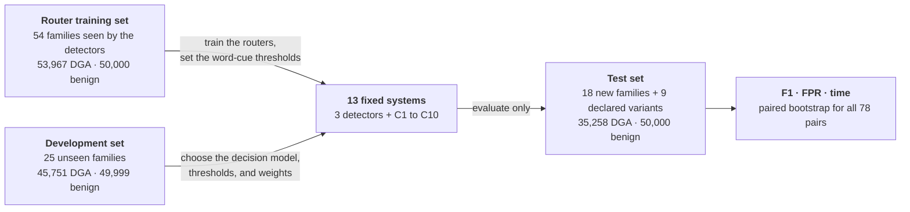

<div align="center">

# Type Cascades for DGA Detection on Unseen Families

**Code, data, and results for the paper _"Type Cascades for DGA Detection on Unseen Families: Balancing F1, False Positives, and Latency"_**

Reynier Leyva La O &middot; Tatiana S. Parlanti &middot; Carlos A. Catania &middot; Rodrigo Gonzalez


-lightgrey)

</div>

Malware uses domain generation algorithms (DGAs) to create many domain names for its servers. A detector
for real DNS traffic must catch domains from DGA families it never saw in training, raise few false alarms,
and answer fast. This repository compares **thirteen systems** on **27 family groups unseen in training**
and judges them on the three metrics together: **F1, false-positive rate (FPR), and time per domain**.

## The idea: a type cascade

<p align="center">
  
</p>

No single detector is best on every DGA family. The fast Logit detector decides most domains alone. Only the
doubtful ones reach a transformer, and a word cue chooses which one: ModernBERT for names built from dictionary
words (wordlist DGAs), DomURLs_BERT for the rest. The word cue only chooses the detector; it never labels the
domain.

## Main result

<picture>
  <source media="(prefers-color-scheme: dark)" srcset="assets/three_metrics_dark.png">
  
</picture>

- **C6** (type cascade with a dictionary rule) and **C3**&dagger; (confidence cascade from Logit to ModernBERT)
  pointwise dominate the most systems, five each, and no system dominates them. C6 had the higher F1 and was faster; C3 had the
  lower FPR.
- Both need about a third of the time of ModernBERT alone, with no clear loss in F1 or FPR.
- C1, the average of the three detectors, has the lowest FPR (2.33%) but needs 5.1 times the time of C6.
- Asking a decision model (d1-3B or Jev) instead of the dictionary rule (C7, C8&dagger;), or letting it judge
  the doubtful domains (C9, C10&dagger;), did not improve this balance.

&dagger; added after the current test run. C5, C6, C7, and C9 were designed using earlier conference-test observations and fixed before the current run. All thresholds were set on router training or development data.

## The ten configurations

<p align="center">
  
</p>

## Evaluation design



All results can be recomputed on a CPU from the saved per-domain predictions in this repository
(see [Reproducing the results](#reproducing-the-results)). Only the Colab notebooks need a GPU, and only to
run the detectors and the local decision model again.

## Related repositories

- [reypapin/dga-multifamily-benchmark](https://github.com/reypapin/dga-multifamily-benchmark): training of the
  three detectors (Logit, ModernBERT, DomURLs_BERT). The checkpoints are in the
  [Hugging Face collection](https://huggingface.co/collections/Reynier/dga-multi-family-benchmark).
- [reypapin/dga-cascade-router](https://github.com/reypapin/dga-cascade-router): our conference study, which
  built the three domain sets used here and first evaluated C1, C2, and C4. The scripts that build the sets
  and the Tranco snapshot of the benign test names are there.

## Data sets

| Set | File | DGA family groups | DGA domains | Benign domains | Use |
|---|---|---|---|---|---|
| Router training | `data/router_train_domains.csv` | 54 seen by the detectors (8 WL, 46 NW) | 53,967 | 50,000 | train the routers, set the word-cue thresholds |
| Development | `data/gate1_domains.csv` | 25 unseen (4 WL, 21 NW) | 45,751 | 49,999 | choose the decision model, thresholds, and weights |
| Test | `data/final_test_domains.csv` | 27 unseen: 18 new and 9 declared variants (4 WL, 23 NW) | 35,258 | 50,000 | evaluate the fixed systems only |

WL: wordlist families, whose names join dictionary words; NW: the other families.
`data/family_taxonomy.csv` and `data/final_test_family_taxonomy.csv` list the families of each set and
their WL/NW type. `data/*doubtful_domains.csv` and `data/router_train_dm_sample_domains.csv` are the inputs
of the decision models: the doubtful domains of each set (Logit confidence below 0.80) and a training
sample of 4,000 WL and 4,000 NW domains.

## Systems

The scripts use earlier internal names. This table maps them to the names in the paper.

| Paper | Name in the code | System |
|---|---|---|
| Logit | `AlwaysLogit` | logistic regression on character n-grams |
| ModernBERT | `AlwaysModernBERT` | fine-tuned ModernBERT-base |
| DomURLs_BERT | `AlwaysDomURLs-BERT` | fine-tuned DomURLs_BERT |
| C1 | `EnsembleMean` | mean of the three scores |
| C2 | `CascadeLogitDomURLs_t0.80` | confidence cascade, Logit then DomURLs_BERT |
| C3 | `Diag_CascadeLogitModernBERT_t0.80` | confidence cascade, Logit then ModernBERT (added after the current test) |
| C4 | `Router` | learned router, 5 seeds |
| C5 | `C1_fpr_router` | learned router with a false-positive cost, 5 seeds |
| C6 | `C2_type_cascade_rule` | type cascade, dictionary rule |
| C7 | `C3_type_cascade_dm` | type cascade, d1-3B |
| C8 | `C3_type_cascade_jev` | type cascade, Jev (designed after the test) |
| C9 | `C4_judge_dm` | doubtful-case judge, d1-3B |
| C10 | `C4_judge_jev` | doubtful-case judge, Jev (designed after the test) |

The routers are `SGDClassifier(loss="log_loss", alpha=1e-4, max_iter=200, tol=1e-3, class_weight="balanced")`
after a `DictVectorizer` and a `StandardScaler`, trained with seeds 7, 17, 29, 43, and 61
(`scripts/train_final_router.py`). The saved routers are in `extension/models/`, with their SHA-256 hashes in
`MANIFEST.json`; loading them needs scikit-learn 1.9.0. All thresholds and weights are in
`extension/config/frozen_v2.json` and `extension/config/posthoc_jev.json`.

## Results on the test set

Default thresholds; time is the mean per domain in milliseconds, without the router features and the
dictionary lookup. C4 and C5 are the mean of five seeds. Bold: C3 and C6, which dominate the most systems.

| System | F1 | FPR | ms |
|---|---|---|---|
| Logit | 0.8874 | 0.0432 | 0.063 |
| ModernBERT | 0.9113 | 0.0303 | 1.899 |
| DomURLs_BERT | 0.8642 | 0.0360 | 1.583 |
| C1 | 0.9133 | 0.0233 | 3.544 |
| C2 | 0.8703 | 0.0320 | 0.616 |
| **C3**&dagger; | **0.9223** | **0.0295** | **0.726** |
| C4 | 0.9175 | 0.0455 | 0.916 |
| C5 | 0.9081 | 0.0368 | 0.522 |
| **C6** | **0.9304** | **0.0304** | **0.689** |
| C7 | 0.9271 | 0.0327 | 20.250 |
| C8&dagger; | 0.9307 | 0.0302 | 162.907 |
| C9 | 0.8740 | 0.1019 | 19.620 |
| C10&dagger; | 0.9002 | 0.0687 | 162.282 |

Source: `extension/results/summary_final_test.csv`. The paired 95% bootstrap intervals for all 78 pairs
are in `extension/results/test_v2_all_pairs.csv` (F1) and `extension/results/test_v2_all_pairs_fpr.csv`
(FPR). For every pair involving C4 or C5, use the updated interval in
`extension/results/revision_router_seed_intervals.csv`: each bootstrap replicate also draws one of the
five router seeds. The original files remain as records of the earlier analysis. The recall of every
system on each test group is in `extension/results/test_v2_per_family.csv`.

The tutor-review checks are reported in four `extension/results/revision_*.csv` files. They include a
random control that keeps the Logit step and randomizes only doubtful cases; WL/NW AUC on test DGA names;
router-seed intervals; and routers retrained without the 1,198 expert/router-training overlaps.
`data/router_expert_overlap.csv` contains the exact overlap index, and its JSON sidecar records the full
expert-training corpus hash. This index reproduces the same exclusion mask without a machine-specific path.
It does not change the original model predictions, thresholds, or frozen files.

## Version

The tutor-review update is version `1.1.0`. `RELEASE_SHA256SUMS` pins the shipped files;
the tag `v1.1.0` marks this version. The frozen protocol hashes remain unchanged.

## Reproducing the results

Python 3.12. From the repository root:

```bash
pip install -r requirements-analysis.txt

# Tests (28) and the hashes of the files fixed before the test run (14 files).
python -m unittest discover -s extension/tests -t .
(cd extension/protocol && sha256sum -c FREEZE.sha256)

# 1. Rebuild the systems of the conference study and check them against its results.
python extension/scripts/reproduce_cacic.py
python extension/scripts/run_diagnosis.py d1d5   # also: d2, d3d4, d6

# 2. Choices made on the training and development sets.
python extension/scripts/dev_c1.py      # C5: false-positive weight
python extension/scripts/dev_c2.py      # C6: dictionary threshold
python extension/scripts/dev_c3c4.py    # C7 and C9: d1-3B thresholds
python extension/scripts/posthoc_jev.py dev   # C8 and C10: Jev thresholds

# 3. Test set.
python extension/scripts/run_test_v2.py --dry-run   # same pipeline on the development set
python extension/scripts/posthoc_jev.py test
python extension/scripts/save_artifacts.py
python extension/scripts/summary_tables.py
python extension/scripts/all_pairs.py
python extension/scripts/all_pairs_fpr.py
python extension/scripts/per_family.py
python extension/scripts/key_comparisons.py
python extension/scripts/fixed_fpr_c4.py

# 4. Tutor-review analyses from saved outputs (no expert or decision-model inference).
python extension/scripts/revision_tutor.py --checks control auc intervals
# Optional: repeats only the linear-router training for the overlap-removal check.
python extension/scripts/revision_tutor.py --checks overlap

# 5. Paper and supplementary tables, including updated router intervals.
python paper/tools/build_tables.py
python paper/tools/build_detector_choice.py
python paper/tools/build_test_summary.py
python paper/tools/build_pairwise_matrix.py

# 6. The plot at the top of this README (written to assets/).
python paper/tools/plot_three_metrics.py extension/results/summary_final_test.csv assets
```

`extension/scripts/run_test_v2.py` without `--dry-run` is the single test run. It checks the hashes first
and refuses to run when `extension/results/test_v2_decision_summary.md` exists. To repeat it, work in a
fresh copy of the repository and delete that file first. We ran all the steps above in a fresh clone: every
result file came out identical, except the run date in `extension/config/posthoc_jev.json` and
`extension/results/posthoc_jev_summary.md` and the gzip headers of the `.csv.gz` files (same content).

`requirements-analysis.txt` pins the packages used for the saved-output analyses. The environment
record is `analysis_environment.json`. The optional model runs use `requirements.txt` and their runtime
metadata; the original notebooks are preserved rather than silently updated.

### Running the models again (optional, GPU)

- Detectors: `notebooks/*_colab_uniform_predictions.ipynb` write
  `experiments/predictions/<set>_uniform_predictions.csv`.
- d1-3B (`LiquidAI/d1-3B`, revision `051bcc464b01b9f92942b364d9586b0ef5912432`, float16 on a T4 GPU):
  `notebooks/decision_models_colab_predictions.ipynb`, with the bundles
  `decision_models_*_colab_content_root_package.zip` (notebook and inputs) and `extension/colab/run_dm.sh`.
  The executed notebooks of our runs are in `extension/colab/logs/`.
- Jev (`typesafe/jev-1.14`, OpenRouter API): `extension/scripts/run_jev_openrouter.py`. It reads the
  OpenRouter key from `~/.local/share/opencode/auth.json` (line 34); change that line to use your own key.
- The exact questions sent to the decision models are in `supplementary/14_appendix_questions.tex` and in
  each `experiments/predictions/*_runtime_metadata.json`.
- `extension/colab/smoke/` holds the trial of Julia-1, Laya, and d1-3B on 400 development domains that chose d1-3B.
- The notebooks download model code from Hugging Face and run it (`trust_remote_code=True`). The main notebook
  pins d1-3B and Julia-1 to fixed revisions, but its Laya branch and the trial scripts in `extension/colab/smoke/`
  install `laya` and load d1-3B without a pinned version. They are kept as they ran; pin the versions before
  running them again.

## Layout

```
data/                     domain sets, family lists, test-set hash
experiments/predictions/  per-domain outputs of the detectors and decision models, with run metadata
experiments/results/      results of the conference study used by the scripts
notebooks/                Colab notebooks (detectors and decision models)
scripts/                  router code of the conference study (imported by extension/lib/cacic.py)
extension/lib/            systems, word rule, decision-model loading, bootstrap
extension/scripts/        analysis scripts (see above)
extension/config/         thresholds and weights
extension/protocol/       analysis plan (in Spanish) and the SHA-256 list of files fixed before the test run
extension/models/         the 10 saved routers (C4 and C5, five seeds each)
extension/results/        every result file used in the paper
extension/tests/          unit tests
extension/colab/          scripts and logs of the decision-model runs
paper/                    generators of the paper tables (written to paper/tables/, not tracked) and the plot in this README
assets/                   figures of this README
supplementary/            extra tables that do not fit in the paper (see supplementary/README.md)
```

## How to cite

The paper reference will be added here once it is published. Until then, please cite this repository
(GitHub button *Cite this repository*, from `CITATION.cff`).

## License

The code is released under the MIT License. The domain names come from the public sources cited in the paper
(DGArchive, 360 Netlab, UMUDGA, UTL_DGA22, CharBot, and Tranco) and keep the terms of those sources.
`extension/data/american-english.txt` is the SCOWL-based word list of the Debian package `wamerican`.
